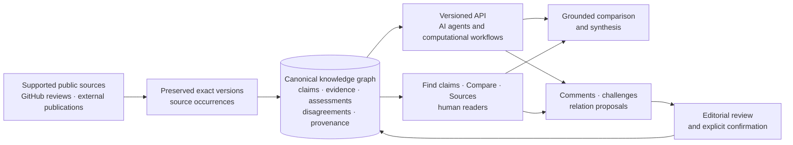

# ORAtlas UI/UX rules

> **ORAtlas helps researchers find and compare scientific claims against their exact sources and
> recorded evidence. Its canonical knowledge graph has two first-class interfaces: a documented API
> for agents and a clear, visual interface for people. Reviews are one publication type; preserved
> source occurrences remain distinct from canonical claim identities.**

This file is the normative UI, API-access, and release contract. See
[`docs/product-experience.md`](docs/product-experience.md) for the wider information architecture and
scientific semantics.

**Design invariant:** the website is not the database, and the API is not a secondary export of the
website. Both expose the same identities, versions, relationships, provenance, and governance state.
Agents must never need to scrape the GUI; people must never need to understand the graph schema
before they can explore it.

## 1. Make the operating model obvious

A first-time visitor should understand within ten seconds that:

- ORAtlas compares recorded claims and evidence from supported public sources;
- each claim refers to an exact preserved source occurrence and version;
- source assertions, assessments, scientific verification findings, and certification conclusions
  are different records;
- missing evidence, unresolved relationships, and incomplete source coverage remain visible;
- public records are available through both a visual website and a documented machine API;
- GitHub sign-in is required for deposit and attributable participation, not ordinary reading of
  public records; and
- archive acceptance is an **editorial decision**, not peer review, correctness, or consensus;
  structural capture establishes provenance, not scientific validation.

The primary human destinations are **Find claims**, **Compare**, and **Sources**. Find claims locates
relevant assertions within the stated available corpus. Compare places two exact claim occurrences
beside their scope, evidence, assessments, and provenance. Sources provides access to registered
publications, archived reviews, and research objects through clearly distinguished collections.

A visible **API & agents** utility must lead directly to documentation, schemas, examples, and
endpoints. Account and role-scoped Editorial remain utilities. Verification, certification,
discussion, graph, coverage, synthesis, and replication records remain reachable through contextual
links and specialist navigation. Moving a destination out of primary navigation does not remove its
records, public routes, or API access.

Source preparation and deposit remain available from Sources through existing supported workflows.
A preparation guide is not an import form; editor-only registration must not be advertised as
unrestricted public import. ORAtlas does not own manuscript authoring, source protocols, or the
scientific algorithms run by independent verifiers.

### Public GitHub review deposit

Reviews originate in public repositories built with, forked from, or compatible with the official
[AllenNeuralDynamics Computational Review Template](https://github.com/AllenNeuralDynamics/ComputationalReviewTemplate).
ORAtlas captures an exact release, tag, or commit through this flow:

1. Create a repository from the AllenNeuralDynamics template.
2. Configure the scope and run the review pipeline.
3. Check the review, evidence packages, figures, provenance, and pipeline gates; do not present
   partial output as complete.
4. Push the repository and publish an immutable tag or GitHub release. A Zenodo DOI is recommended,
   not required.
5. Sign in to ORAtlas, select the exact source version, verify the extracted metadata and validation
   report, and deposit it for acceptance, changes, or rejection.

## 2. Design one graph for two first-class interfaces

### 2.1 AI agents and computational workflows: API first

- The API is a complete product surface. An agent can discover reviews, retrieve immutable versions,
  enumerate claims and evidence, traverse typed relations, inspect assessments and disagreements,
  and follow update lineage **without a web page, browser session, or DOM scraping**.
- Publish a prominent API landing page with an OpenAPI contract, machine-readable schemas,
  authentication and rate-limit rules, and a copyable quick start:
  **retrieve review → list claims → traverse evidence → inspect provenance and disagreements**.
- Public accepted records should be readable without GitHub authentication unless a documented
  safety or rate-limiting exception applies. Authenticated writes remain attributable.
- Use stable canonical identifiers and versioned endpoints and schemas. Every response identifies the
  exact entity version, provenance, lifecycle state, relation state, and corresponding human page.
- Use database-native cursor pagination for every node and edge collection. Every bounded response
  states whether it is complete, truncated, filtered, or still pageable.
- Expose a versioned graph snapshot and change feed so agents can synchronize incrementally.
  Deterministic filters, ordering, errors, and idempotent writes are part of the agent UX.
- The API and GUI must use the same canonical graph or immutable event/store. A GUI-only core action
  is an incomplete feature; optional identity bridges must not become permanent architecture.

### 2.2 Human readers: didactic, visual, and personalized

- Find claims uses one question or topic input and readable results. Each discovery surface states
  its source collection, filters, and bounded coverage. Separate collections must not be described
  as a complete unified search.
- Sources is a presentation grouping over existing records, not a new authoritative identity or
  storage model. Publication identity, exact version identity, source occurrence, and canonical
  claim identity remain distinct. Equal text, local IDs, or digests do not establish shared identity.
- Start from a plain-language question, topic, review, or declared interest. Offer a small number of
  explanatory starter paths rather than opening on a dense, unlabeled graph.
- Treat the graph as an **explanatory map**, not a decorative node cloud. Consistent visual semantics
  distinguish reviews, claims, evidence, assessments, disagreements, datasets, code, versions, and
  proposed versus confirmed relations.
- Every visible node or edge should answer: **What is this? Why am I seeing it? What supports it? How
  does it connect to earlier knowledge? What changed?** Plain-language explanations precede
  specialist metadata.
- Make new-to-old connections explicit through typed relations such as **confirms, contradicts,
  extends, updates, reuses evidence from**, or **no confirmed connection**. Never manufacture a link
  merely to avoid an isolated node.
- Use progressive disclosure: explanatory path first, source review and claim passport second, full
  graph indexes and specialist controls on demand. The complete review remains easy to read.
- Personalization may use explicitly selected interests, domains, preferred depth, or saved topics.
  It must be transparent, reversible, and explain every recommendation. It changes ranking and
  presentation, never canonical graph state. An unpersonalized view and reset control remain
  available.
- Preserve orientation: the active question, selected path, source review, graph neighborhood, and
  return route remain visible. Provide labels, legends, keyboard access, non-color cues, responsive
  layouts, and a readable non-graph alternative.

## 3. Preserve records and govern participation

- Preserved source context remains accessible from every claim and comparison. Archived reviews
  remain readable in full, with expandable figures and captions. Externally observed publications
  expose the captured content and coverage actually available, recorded provenance, and the original
  publication link. An upstream URL is not an immutable ORAtlas source record.
- The evidence path is **claim → evidence → assessment or disagreement → preserved source context**;
  reading a source first remains supported. Repository, commit/tag/release, exact version, AI/run
  provenance, and editorial status remain visible where applicable.
- Comments may address a review, exact claim, claim–evidence relation, or preserved passage. Clearly
  distinguish discussion, formal challenge, TRUST assessment, editorial decision, and graph-change
  proposal.
- A comment never edits an accepted review. Resolution links to an answer, editorial decision, or
  replacement GitHub version with diff and lineage. Historical discussions remain readable;
  moderation leaves an auditable tombstone.
- Reviews, versions, claims, evidence, assessments, discussions, and typed relations are canonical
  graph entities with stable identities and immutable versions, or are generated from one canonical
  immutable store.
- Source-declared evidence relations remain attributed source assertions, distinct from
  editor-confirmed relations. Humans and LLMs may propose a relation; a proposal becomes a confirmed
  relation only through an explicit editorial decision. A comparison or comment never confirms an
  edge, and an editor-approved isolated concept is valid.
- Every node and edge exposes its applicable provenance, exact version, attribution, rationale,
  lifecycle or relation status, and change history within existing visibility rules. Proposals remain
  distinct from confirmed relations. Semantic similarity may suggest a link but never
  silently merges identities, sources, or conflicting interpretations.
- Safe rendering never executes repository HTML, iframes, styles, or plugins. Passage annotations
  are version-bound, source-anchored, and available to agents in machine-readable form.

## 4. Compare exact claims and ground later synthesis

### 4.1 Exact-pair comparison

- Identify both exact claim occurrences and preserve those references when copied or reopened.
  Never silently substitute a latest version, text match, or different source. Invalid, unavailable,
  or unsupported references produce an explanation and a recoverable selection state.
- Show each assertion, recorded scope, source context, evidence relations, assessments, and recorded
  relationship status. Missing scope or evidence is a coverage gap, not a negative quality judgment.
  The available records may not establish a relationship; a bounded read must disclose truncation.
- Shared citations, datasets, authorship, laboratories, and derivation links are overlap facts.
  Repeated citation is not independent corroboration, and absence of recorded overlap does not
  establish independence. Deterministic scope matching does not establish scientific contradiction.
- Copying a comparison URL preserves selected references. It does not save a personal judgment,
  create a governed comparison record, merge identities, or grant private workspace access. Reopening
  the pair rechecks the applicable public lifecycle and visibility rules.

### 4.2 Contextual discussion and synthesis

- Explore and Atlas Discuss form one workflow: the selected graph path and source records remain
  visible before or beside any generated answer.
- Cross-review synthesis uses canonical identities, confirmed relations, or clearly labeled
  proposals. Shared sources are grouped so repeated citation does not create false consensus;
  disagreements, scope differences, missing evidence, and uncertainty remain visible.
- Every generated statement cites exact node versions, source reviews, and its supporting graph path.
  Model/provider, task or prompt, run, evidence packet, and generation status are inspectable through
  both GUI and API.
- An LLM may propose links or draft synthesis. It may not rewrite a preserved review or confirm an
  edge. A saved or published synthesis is a separate, versioned derivative record with source
  lineage, software provenance, staleness detection, and an accountable editorial decision.

## 5. End-to-end release gates

A route, diagram, or button is not sufficient. Verify these journeys with real, non-demo records:

1. Sources → Public GitHub deposit → Allen template guidance → GitHub sign-in → exact-version capture →
   validation → editorial status → public immutable review.
2. Full review and figures → claim → evidence → assessment/disagreement → provenance.
3. API documentation → copyable quick start → retrieve a real review → list claims → traverse
   evidence and disagreement records, without the GUI.
4. Paginate real node and edge collections with explicit completeness metadata; obtain a graph
   snapshot and consume a versioned change feed event.
5. Question or declared interest → explained starter paths → reason for each recommendation → full
   unpersonalized result set and reset control.
6. Newly accepted review → explicit typed, confirmed connections to older insights—or **no confirmed
   connection**—with relation proposals shown separately as non-canonical → supporting evidence and
   provenance.
7. Claim or passage → comment → reply → challenge or relation proposal → editorial resolution or new
   version → diff, graph transition, and lineage.
8. Explore at least two reviews → grounded multi-review answer → exact source highlighting → saved or
   published synthesis without mutating source reviews.
9. Confirm that the same entities, proposals, status changes, and synthesis records appear through
   API and GUI with identical canonical identities.
10. Find claims → stated corpus and filters → readable results or recoverable empty state → exact
    claim and source context.
11. Compare → two exact claim occurrences → scope, evidence, and source context → copy references →
    reopen the same pair with lifecycle checks. Also exercise the home example with its synthetic
    label and unavailable-fixture fallback; an example alone does not validate real-source coverage.
12. Sources → the intended source collection → exact version → captured content, claims, checks, and
    history where available. Source-type links do not imply cross-source search.

Fail the release when a core action is a placeholder, demo content appears real, an accepted review
cannot be read in full, an agent must scrape HTML, a bounded API response hides truncation,
personalization cannot be reset, a graph link lacks an explanation, or an LLM statement cannot
resolve to exact source versions.

These are product release requirements, not a claim that every journey or future capability is
implemented. Record executed checks, fixture scope, and remaining gaps explicitly; navigation changes
do not establish graph synchronization, saved comparisons, or private collaboration.

### Compatibility and public-contract review

Preserve existing human routes and their exact-version, query, filter, and fragment semantics. API
URLs, schemas, canonical identifiers, version/concept DOI distinctions, evidence subjects, source
pins, and immutable history do not change with navigation labels. Producer integrations continue to
require exact contract fixtures, source pins, negative tests, and rollback plans; local validation
alone does not certify cross-repository interoperability.

Use the applicable [G1 public-contract harness](docs/private-workspace-g1-harness.md) when rendered
public contracts change. Capture and review baseline differences through the harness; never hand-edit
captures or automatically accept a failed comparison. Report coverage and remaining gaps. A passing
navigation check does not pass G1 or authorize private tables, data, or services. Rollback restores the
prior presentation without rewriting scientific records.

## Language rules

Use **Find claims**, **Compare**, **Sources**, **canonical knowledge graph**, **API & agents**,
**deposit repository**,
**accepted into the archive**, **AI-generated synthesis**, **proposed relation**, and
**editor-confirmed relation**. Avoid **upload paper**, **peer-reviewed**, **truth score**, or
**consensus** unless the underlying record explicitly supports that wording.
